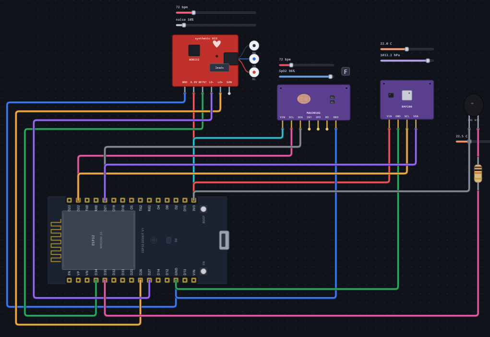

# MedMonitor-IoT

An ESP32-based IoT multi-parameter health monitoring system that collects physiological and environmental data using multiple sensors and displays the readings through a live Python web dashboard.

<p align="center">
  
</p>

## Overview

MedMonitor is an electronics and IoT project designed to monitor multiple parameters simultaneously using an ESP32 microcontroller.

The system integrates ECG monitoring, optical heart-rate and blood oxygen estimation, skin-contact temperature measurement, and environmental monitoring.

Sensor readings are processed by the ESP32 and transmitted over USB serial to a Python Flask dashboard for real-time visualization.

## Features

- **ECG Monitoring:** Captures ECG signals using the AD8232 module.
- **Heart Rate Monitoring:** Estimates heart rate using the MAX30102.
- **SpO₂ Monitoring:** Estimates blood oxygen saturation using the MAX30102.
- **Skin Temperature:** Measures local skin-contact temperature using a 10kΩ NTC thermistor.
- **Ambient Temperature:** Measures surrounding temperature using the BMP280.
- **Atmospheric Pressure:** Measures atmospheric pressure using the BMP280.
- **Live Dashboard:** Displays sensor readings and ECG waveform through a Python Flask web interface.
- **Signal Processing:** Uses moving-average filtering for ECG and median filtering with exponential smoothing for heart-rate readings.

## Hardware Components

| Component | Purpose |
|---|---|
| ESP32 DevKit | Main microcontroller |
| AD8232 ECG Module | ECG signal acquisition |
| MAX30102 | Heart rate and SpO₂ estimation |
| BMP280 | Ambient temperature and pressure |
| 10kΩ NTC Thermistor | Skin-contact temperature estimation |
| 10kΩ Resistor | NTC voltage divider |
| ECG Electrodes | ECG signal acquisition |
| Breadboard / Perfboard | Circuit assembly |
| Jumper Wires | Electrical connections |

## Pin Configuration

### AD8232

| AD8232 Pin | ESP32 GPIO |
|---|---|
| OUTPUT | GPIO 34 |
| LO+ | GPIO 26 |
| LO- | GPIO 27 |
| GND | GND |
| 3.3V | 3.3V |

### MAX30102

| MAX30102 Pin | ESP32 GPIO |
|---|---|
| SDA | GPIO 21 |
| SCL | GPIO 22 |
| VIN | 3.3V* |
| GND | GND |

### BMP280

The BMP280 shares the I²C bus with the MAX30102.

| BMP280 Pin | ESP32 GPIO |
|---|---|
| SDA | GPIO 21 |
| SCL | GPIO 22 |
| VIN | 3.3V* |
| GND | GND |

### NTC Thermistor

The NTC is connected through a voltage divider.

| Connection | ESP32 |
|---|---|
| Measurement junction | GPIO 35 |
| Supply | 3.3V |
| Fixed resistor | 10kΩ |
| Ground | GND |

Voltage divider configuration:

`3.3V → NTC → GPIO 35 → 10kΩ resistor → GND`

*Verify the voltage requirements of the specific sensor breakout boards before powering them.*

## Software and Technologies

- **Arduino IDE** – ESP32 firmware development.
- **C/C++** – Sensor interfacing and data processing.
- **Python** – Serial data acquisition and dashboard backend.
- **Flask** – Local web dashboard.
- **HTML, CSS and JavaScript** – Dashboard interface and live visualization.
- **PySerial** – ESP32 serial communication.

## Project Architecture

```text
       AD8232 ECG Module
               |
          MAX30102
               |
           BMP280
               |
         NTC Thermistor
               |
               v
          ESP32 DevKit
               |
          USB Serial
               |
               v
        Python / PySerial
               |
               v
          Flask Server
               |
               v
        Web Dashboard
               |
       Live Sensor Readings
```

## Getting Started

### 1. Clone the Repository

```bash
git clone https://github.com/YOUR_USERNAME/MedMonitor-IoT.git
cd MedMonitor-IoT
```

### 2. Install Python Dependencies

```bash
py -m pip install flask pyserial
```

### 3. Upload ESP32 Firmware

1. Open the ESP32 firmware `.ino` file in Arduino IDE.
2. Install the required libraries:
   - Adafruit BMP280 Library
   - Adafruit Unified Sensor
   - Adafruit BusIO
   - SparkFun MAX3010x Pulse and Proximity Sensor Library
3. Select the appropriate ESP32 board and COM port.
4. Upload the firmware.

### 4. Configure the Dashboard

Open the Python dashboard file and configure the serial port if necessary.

```python
COM_PORT = "COM5"
BAUD_RATE = 115200
```

### 5. Run the Dashboard

Close Arduino IDE Serial Monitor before starting the Python application.

```bash
py medmonitor_db.py
```

Open the dashboard in your browser:

```text
http://127.0.0.1:5000
```

## Data Communication

The ESP32 transmits sensor readings through USB serial communication at 115200 baud.

The firmware uses two primary message formats:

- `ECG,<value>` – Continuous ECG samples.
- `DATA,<values>` – Periodic sensor measurements, including temperature, pressure, optical readings, heart rate and SpO₂.

The Python application parses these messages and updates the dashboard.

## Limitations and Safety

- This project is an educational prototype, not a certified medical device.
- MAX30102 heart-rate and SpO₂ readings are algorithmic estimates and require validation.
- NTC measurements represent local skin-contact temperature, not core body temperature.
- NTC temperature accuracy depends on thermistor specifications and calibration.
- ECG signals can be affected by electrode placement, movement and electrical noise.
- Do not use the readings for medical diagnosis or treatment decisions.
- Human ECG testing requires appropriate electrical isolation. Do not attach electrodes to a person while the ESP32 is connected to a non-isolated, mains-powered USB computer or charger.

## Project Status

**Development in progress.**

The project integrates the ESP32, ECG module, optical sensor, temperature sensor and environmental sensor with a live Python dashboard. Hardware integration, sensor calibration, signal quality improvements and interface development are ongoing.
